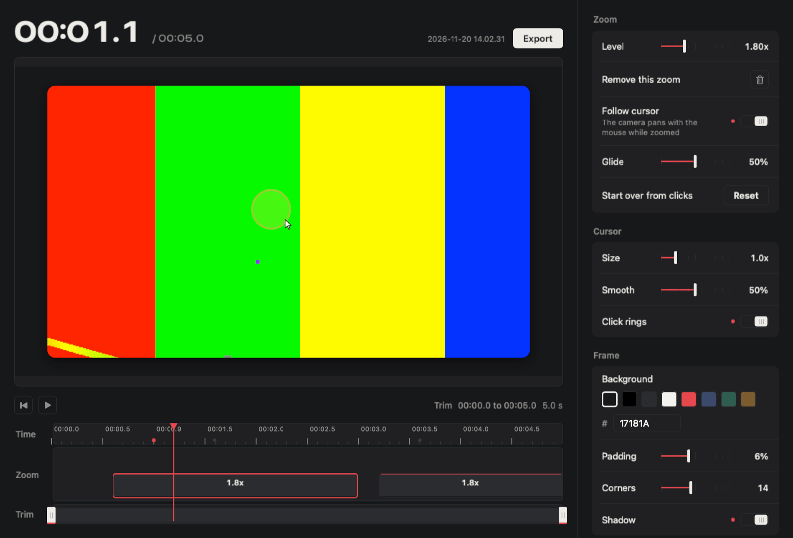

# Reel

Record your screen for demos and turn every click into a smooth zoom.

<p align="center"></p>

<p align="center">    </p>

Requires macOS 15 or later.

## What it does
- Records a display, a window or a dragged area at 60 fps (or 30), without the system cursor. Big and ultrawide screens work too.
- Records the Mac's sound (notification sounds included) and, optionally, the microphone. Mac sound is on by default and has a switch in the menu and in Settings.
- If a recording is cut short by a lock, sleep or an unplugged display, what was captured is saved and opens as a project.
- Every click, or cluster of clicks, becomes a zoom. Drag its key up or down (or use the slider) to set how far it zooms, or delete it; Reset starts over from the clicks.
- The cursor and click rings are drawn afterwards from a mouse log.
- Frame the video: background colour, padding, corners, shadow.
- Export MP4 (H.264 or HEVC, 1080p or source size) or GIF (needs ffmpeg).

## Keyboard
| Action | Shortcut |
|---|---|
| Start / stop recording | ⌃⌥R (changeable) |

## Install

**Homebrew**

```
brew tap noterikkirillov8/tap
brew trust noterikkirillov8/tap
brew install --cask reel
```

**Download**: get `Reel-1.0.0.zip` from [Releases](https://github.com/noterikkirillov8/reel/releases), unzip it and drag `Reel.app` to Applications.

**Build from source**: see below.

Reel isn't notarised by Apple (that needs a paid developer account), so the first time macOS may say it can't verify the developer: open System Settings → Privacy & Security, scroll down and click Open Anyway (on macOS 15 and later right-click → Open no longer works). The Homebrew cask clears that flag for you.

GIF export needs ffmpeg (`brew install ffmpeg`); the option is hidden without it.

## How it works
Reel captures the screen (and the Mac's sound, if on) with ScreenCaptureKit and logs mouse position and clicks separately (never keystrokes). The editor turns clicks into zoom segments, and the final frames, cursor and rings are composed from those two files, so you can change everything after recording. Recordings live in `~/Movies/Reel/<date>/` as `capture.mov`, `events.json` and `project.json`.

## Permissions
- **Screen Recording**: asked the first time you press Record. It also covers the Mac's sound.
- **Microphone**: asked only if you turn the microphone on in Settings.

**Live capture is new** in 1.0 and has had little real-world testing: try a short recording first.

## Privacy
Reel records only when you press Record. Everything stays on your Mac: no network, no telemetry, no update checks.

## Build from source
Needs Xcode 16+ and [XcodeGen](https://github.com/yonaskolb/XcodeGen).

```
scripts/test.sh                  # tests
NO_OPEN=1 scripts/install.sh      # build Release and install to /Applications
```
`scripts/install.sh` signs with the author's local certificate if you have it, and ad hoc otherwise, so it works on any Mac.

## Credits
MIT licence. Interface sounds by Kenney (kenney.nl), CC0.

---
Part of Patchbay: [Harbor](https://github.com/noterikkirillov8/harbor) / [Tally](https://github.com/noterikkirillov8/tally) / [Sweep](https://github.com/noterikkirillov8/sweep) / [Ledge](https://github.com/noterikkirillov8/ledge) / [Switchboard](https://github.com/noterikkirillov8/switchboard) / [Shutter](https://github.com/noterikkirillov8/shutter) / [Reel](https://github.com/noterikkirillov8/reel) / [Vigil](https://github.com/noterikkirillov8/vigil)
